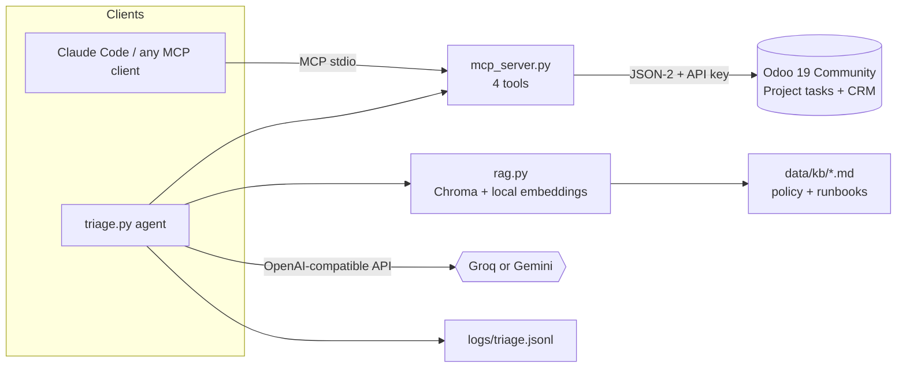

# MSP Ops Copilot

A small, working example of an AI assistant for a managed IT service desk. It reads tickets from Odoo, triages them with an LLM using the company's own written policy, and writes a reviewable note back. Built to run entirely on free tiers.

> Demo data only. The customers, tickets and policy documents are fictional.

## What it demonstrates

| Capability | Where |
|---|---|
| Multi-provider LLM access (Groq, Gemini) behind one interface | `llm.py` |
| Tool calling loop written by hand, with a step cap | `agent_basic.py`, `tools.py` |
| Custom MCP server exposing Odoo (read tools + one narrow write) | `mcp_server.py` |
| Odoo integration through the JSON-2 API with an API key | `odoo_client.py`, `seed_odoo.py` |
| Structured output validated with Pydantic, one retry with the error | `triage.py` |
| RAG: section chunking, local embeddings, Chroma, cited answers | `rag.py`, `data/kb/` |
| Safety: dry-run default, escaped notes, no delete tool, idempotent re-runs, audit log | `triage.py`, `mcp_server.py` |
| Tests that never call a real LLM or Odoo | `tests/` |

## Architecture



Flow for one ticket: fetch ticket from Odoo, retrieve the relevant policy sections, ask the model for JSON matching the `Triage` schema, validate (retry once with the validation error), print it, and with `--write` post it to the ticket as an internal note that lists the policy sections used.

## Design decisions

- **Tickets are Project tasks.** Odoo Helpdesk is an Enterprise module. On Community, a "Service Desk" project gives the same shape of data.
- **JSON-2 API, not XML-RPC.** Odoo has deprecated the older endpoints.
- **The AI can only do what the MCP server exposes.** There is no delete or free-form update tool. The only write adds a plain-text note, and only to tickets in the Service Desk project.
- **Fixed enums for category and priority.** The schema guarantees valid values. The policy documents decide which value is right, so two different models agree (checked on Groq and Gemini).
- **Citations come from retrieval, not from the model.** The note lists what was retrieved, so a source cannot be invented.
- **Relevance cutoff.** Vector search always returns nearest neighbours, so sections farther than `MAX_DISTANCE` are dropped.
- **Dry run by default.** Nothing is written without `--write`. Already-triaged tickets are skipped unless `--force`.
- **Local models.** Not run here (no spare hardware). The model sits behind `base_url`, `api_key` and `model`, and Ollama, vLLM and llama.cpp expose the same OpenAI-compatible API, so adding one is a new entry in `PROVIDERS` in `llm.py` (see below).

## Setup

Requirements: Docker Desktop, [uv](https://docs.astral.sh/uv/), free API keys from Groq and Google AI Studio.

1. Start Odoo (separate folder `odoo-lab`, so it can be reused for other projects): `docker compose up -d` there, then initialise a database named `mspdemo` with the `contacts`, `crm` and `project` modules.
2. Create an Odoo API key for the integration user (Preferences > Account Security).
3. Copy `.env.example` to `.env` and fill in the keys by editing the file. Never paste keys into chat or commit them.
4. `uv sync`
5. `uv run python -m msp_ops_copilot.seed_odoo` (safe to run twice)
6. `uv run python -m msp_ops_copilot.rag ingest`

## Usage

```bash
uv run python -m msp_ops_copilot.agent_basic "Which open tickets look urgent?"
uv run python -m msp_ops_copilot.rag ask "What is the response target for a high priority ticket?"
uv run python -m msp_ops_copilot.triage            # dry run
uv run python -m msp_ops_copilot.triage --write    # post notes to Odoo
uv run pytest                                      # offline tests
```

Register the MCP server in Claude Code (user scope):

```bash
claude mcp add --scope user msp-odoo -- uv --directory <path-to-this-repo> run python -m msp_ops_copilot.mcp_server
```

Switch provider with `LLM_PROVIDER=groq|gemini` in `.env`.

### Using a local model later

Add an entry to `PROVIDERS` in `llm.py`, for example Ollama:

```python
"ollama": Provider("ollama", "http://localhost:11434/v1", "OLLAMA_API_KEY", "OLLAMA_MODEL"),
```

Set any non-empty `OLLAMA_API_KEY`, pick a model that supports tool calling and JSON output, and set `LLM_PROVIDER=ollama`. Not tested in this repository.

## Reset the demo

In `odoo-lab`: `docker compose down -v`, initialise again, then re-run the seed script and `rag ingest`. Without a reset, old AI notes stay on the tickets.

## Known limits

- Free-tier rate limits apply and change. Model names also change, so check them in each provider's console.
- Priority accuracy has been compared by eye on four tickets, not measured on a labelled set.
- `MAX_DISTANCE = 0.75` was chosen from a handful of queries and needs tuning on real questions.
- The knowledge base is five short documents. Quality depends entirely on keeping real policy documents current.
- Notes are drafts for human review. The system never replies to customers.
