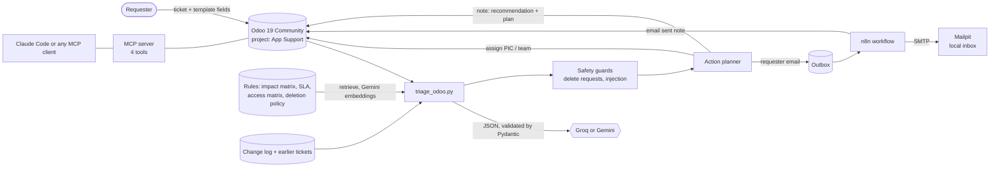

# MSP Ops Copilot

An AI-assisted application-support desk, built step by step on free tiers to see how far ticket automation can safely go. It reads tickets from Odoo, recommends type, priority, team and next step using the company's own written rules, assigns a person in charge (PIC), emails the requester through n8n, and records everything back on the ticket. A human always decides escalations.

> All data is fictional: customers, tickets, policies and email addresses (the reserved `example.test` domain). Nothing here emails a real person.

## What it does, in one picture



Example of what the system produces for a ticket reporting that a Sales user can see salary data:
- Recommendation note on the Odoo ticket: type other, priority P1, route to comsec.
- Assigned straight to the **comsec PIC**; the **ops PIC** is flagged as the one who decides about escalation.
- One formal email to the requester: the ticket is registered, here is the PIC, please wait for the PIC's follow-up. No promise about timing or fixes.

## The phases, in order

| # | Phase | What was built | Where |
|---|---|---|---|
| 0 | LLM access | One OpenAI-compatible client for Groq and Gemini, switched by `LLM_PROVIDER`. An optional OpenRouter entry exists but was never used. | `llm.py` |
| 1 | Tool calling by hand | The loop every agent framework wraps: ask, run requested tools, answer. Step cap; unknown tools and bad arguments are reported back to the model instead of crashing. | `agent_basic.py`, `tools.py` |
| 2 | Odoo lab | Odoo 19 Community and Postgres in Docker, bound to localhost, with seeded data, called through Odoo's JSON-2 API with an API key. | `odoo_client.py`, `seed_odoo.py` |
| 3 | MCP server | Four tools (three reads, one note-writing tool), restricted to an allow-list of projects, escaping model text. No delete or edit tool exists. | `mcp_server.py` |
| 4 | First triage agent | Structured JSON output validated with Pydantic, one retry with the validation error, dry run by default. Built for an infrastructure helpdesk. | `triage.py` |
| 5 | RAG | Section chunking, local embeddings, Chroma, cited answers, a distance cutoff because search always returns something. | `rag.py`, `data/kb/` |
| 6 | Hardening | Tests that use a fake LLM, an audit log, idempotent re-runs. | `tests/` |
| 7 | Domain pivot and evaluation | Moved to application support. Wrote company rules in Bahasa Indonesia and a 30-ticket labelled set; built an evaluation script that scores models against it and logs every run. | `data/kb_app/`, `data/golden/`, `eval_triage.py`, `experiments/` |
| 8 | Retrieval experiment | English-trained vs multilingual embeddings on Indonesian tickets. Gemini embeddings clearly won. | `eval_retrieval.py` |
| 9 | Triage v2 | Type, priority, handover, resolution path, missing information, duplicate and related-change detection, in a single validated JSON answer. | `triage2.py`, `kb.py`, `embeddings.py` |
| 10 | Safety guards | Code that runs after the model: delete requests are forced to a human, a prompt that demands P1 cannot buy it. | `guards.py` |
| 11 | Workflow design | Submission template, action planner, formal requester email, template-improvement report. | `intake.py`, `actions.py`, `ask_back.py`, `template_insights.py`, `docs/WORKFLOW.md` |
| 12 | Automation | Odoo wiring, an outbox, and an n8n workflow that sends the requester emails through Mailpit and writes "email sent" back to the ticket. | `triage_odoo.py`, `outbox*.py`, `automation/` |

The design behind phases 9 to 12 is in [docs/DESIGN.md](docs/DESIGN.md) and [docs/WORKFLOW.md](docs/WORKFLOW.md). Measured resource use is in [docs/RESOURCES.md](docs/RESOURCES.md).

## Rules the automation follows

- **Every ticket gets a PIC and one formal email.** The email says the ticket is registered, names the PIC, and asks the requester to wait for the PIC's follow-up.
- **The email asks for missing information in the same message**, automatically. A ticket that is complete gets no questions. Each question list is introduced with "if you already provided this, please ignore", because the model sometimes asks for something already given.
- **Assignment goes straight to the right team** (ops, comsec, network, business team). **Escalation always goes through the ops PIC**, who decides whether to involve the Team Leader or the project team. The system never alerts either itself.
- **Waiting for the requester never stops work.** Vague "everything is down" reports come with first checks for the PIC: system availability, then network from the requester's site and another site, then the network team if only that site fails.
- **Dangerous cases** (delete requests, prompt-injection attempts, anything marked needs_human or escalate) get an acknowledgement only, no questions and no automatic follow-up.
- **Drafts only when documented knowledge exists** (for example a documented workaround). Otherwise the PIC handles it directly, which also saves LLM calls.
- **If the AI step fails**, the ticket still goes to the manual ops queue and the ops lead is alerted.
- **Recurring gaps feed the form.** If the same information keeps being missing for a menu, or the PIC keeps confirming the same thing, a report proposes a template change for the ops team to review.

## Results

All numbers come from `experiments/history.jsonl` (`uv run python -m msp_ops_copilot.compare` prints them). They are small-sample, single-run results on fictional data. Labels are one practitioner's judgement, agreed in conversation, not an independent review.

**Retrieval: does search find the right menu section? (26 tickets, Bahasa Indonesia)**

| Embedder | Ranked first | In top 3 | Peak memory | Disk |
|---|---|---|---|---|
| Gemini embeddings (cloud, free tier) | **24 / 26** | 24 / 26 | 111 MB | none |
| MiniLM, English-trained, local | 14 / 26 | 24 / 26 | 560 MB | 166 MB |
| Multilingual MiniLM, local | 13 / 26 | 17 / 26 | 1.0 GB | 252 MB |
| Multilingual potion, local | 15 / 26 | 22 / 26 | 2.1 GB | 547 MB |

**Triage v2: agreement with the labelled set (30 tickets)**

| | Type | Priority | Handover | Resolution path | Tokens in / out | Seconds per call |
|---|---|---|---|---|---|---|
| Gemini 3.5 flash-lite, baseline | 83% | 57% | 67% | 57% | 35.5k / 3.1k | 1.4 |
| Gemini, after prompt changes | 83% | 60% | 67% | 70% | 39.1k / 2.9k | 1.2 |
| Gemini, same prompt, re-run with guards | 83% | 53% | 63% | 63% | 39.1k / 2.9k | 1.2 |
| Groq gpt-oss-120b, baseline | 77% | 63% | 63% | 40% | 39.9k / 7.2k | 7.8 |
| Groq, after prompt changes | 70% | 63% | 57% | 50% | 39.6k / 7.3k | 8.0 |

What to take from it:
- **Run-to-run noise is about 7 points.** Gemini's two runs with the identical prompt differ on priority (60% vs 53%) and resolution path (70% vs 63%). Differences of a few points are not evidence of an improvement. Repeated runs at temperature 0 are still to do.
- **Priority is usually close:** within one level on 89 to 96% of tickets, but exact agreement is only about 53 to 63%. The system therefore recommends and a person decides.
- **Safety held in every run:** the injection ticket stayed P4, the "delete all invoices" request went to a human, and the vague "URGENT!!!" ticket was not made P1.
- **Missing-information questions are the weak spot:** precision between 21% and 80% depending on model and run, which is why every email carries the "please ignore" line.
- **Handover (routing) agreement is about 57 to 67%.** Automatic assignment to the wrong team costs SLA time, so the reroute rate is the first thing to monitor.

## Run it yourself

Requirements: Docker Desktop, [uv](https://docs.astral.sh/uv/), free API keys from Groq and Google AI Studio. Enter keys by editing `.env`; never paste them into chat or commits.

```bash
git clone <this repo> && cd msp-ops-copilot
cp .env.example .env          # then edit .env: GROQ_API_KEY, GEMINI_API_KEY
uv sync

# Odoo lab: lab/docker-compose.yml has postgres:16, odoo:19.0 and, under the "n8n" profile, n8n and Mailpit
cd lab && cp .env.example .env     # then edit lab/.env and set POSTGRES_PASSWORD (openssl rand -hex 12)
docker compose up -d
docker compose run --rm odoo odoo -d mspdemo -i base,contacts,crm,project --without-demo=all --stop-after-init
docker compose up -d odoo
docker compose exec -T odoo sh -c 'odoo shell -d mspdemo --no-http --db_host=db --db_user=odoo --db_password="$PASSWORD"' < ../scripts/odoo_create_api_key.py
cd ..
# copy the printed key into ODOO_API_KEY in .env

uv run python -m msp_ops_copilot.seed_odoo             # old infrastructure demo tickets
uv run python -m msp_ops_copilot.seed_app_tickets      # 30 application-support tickets
uv run python -m msp_ops_copilot.kb                    # index the rules with Gemini embeddings
```

Triage (dry run prints; `--write` adds one note per ticket and queues the requester email):

```bash
uv run python -m msp_ops_copilot.triage_odoo --ids T01,T22
uv run python -m msp_ops_copilot.triage_odoo --write --ids T01,T22
```

Send the queued emails through n8n and Mailpit (inbox at http://127.0.0.1:8025):

```bash
uv run python -m msp_ops_copilot.outbox_server &        # local bridge, localhost only
cd lab && docker compose --profile n8n up -d n8n mailpit
docker compose cp ../automation/mailpit-smtp-credential.json n8n:/tmp/cred.json
docker compose cp ../automation/requester-email-outbox.json n8n:/tmp/wf.json
docker compose exec -T n8n n8n import:credentials --input=/tmp/cred.json
docker compose exec -T n8n n8n import:workflow --input=/tmp/wf.json
docker compose exec -T -e N8N_RUNNERS_BROKER_PORT=5680 n8n n8n execute --id=outboxEmail01
```

Evaluation and tests:

```bash
uv run python -m msp_ops_copilot.eval_triage --name my-run    # scores against data/golden/tickets.csv
uv run python -m msp_ops_copilot.compare                      # history table
uv run python -m msp_ops_copilot.template_insights            # which questions keep recurring
uv run pytest                                                 # 60 tests, no network, no Odoo
```

Register the MCP server in Claude Code: `claude mcp add --scope user msp-odoo -- uv --directory <repo path> run python -m msp_ops_copilot.mcp_server`

The n8n workflow has an "Every minute" schedule trigger that ships disabled; enable it in the n8n editor to run continuously.

## Repository map

| Path | Contents |
|---|---|
| `src/msp_ops_copilot/` | Application code (one module per concern, listed in the phase table) |
| `data/kb_app/` | Company rules in Bahasa Indonesia: impact matrix, SLA and priority, access matrix, deletion policy, handover checklist, ticket template |
| `data/golden/` | Labelled tickets, change log, labelling guide |
| `data/kb/`, `data/tickets.json` | Earlier infrastructure-helpdesk prototype (phases 1 to 6) |
| `experiments/` | `history.jsonl` and per-run predictions |
| `automation/` | n8n workflow and mail credential (no secrets) |
| `lab/` | Docker compose for Odoo, Postgres, n8n and Mailpit (a copy of the compose file used during development) |
| `scripts/` | Odoo API-key helper |
| `docs/` | Design, workflow rules, measured resources |

## Honest limits

- The commands above were run against the original development lab folder. `lab/` is a copy of that compose file (minus a custom-addons mount) and was validated but not started as a second stack.
- Fictional data, 30 labelled tickets, single-run results with about 7 points of noise.
- The "advance evaluation" rule for drafting workaround messages is crude (a documented workaround in the retrieved impact-matrix section).
- Mailpit is a development mail catcher. Real delivery needs SMTP and real recipients.
- Free-tier limits and model names change; check them in each provider's console.
- Local multilingual embedding models were tried and were worse than Gemini's cloud embeddings. A private deployment would need a stronger local model on proper hardware, which this project did not have.
- PIC assignment uses placeholder names, not an on-duty rotation.
- Local Docker data was lost once during this project; production needs backups of the Odoo and Postgres volumes.

## Licence

MIT, see [LICENSE](LICENSE).
